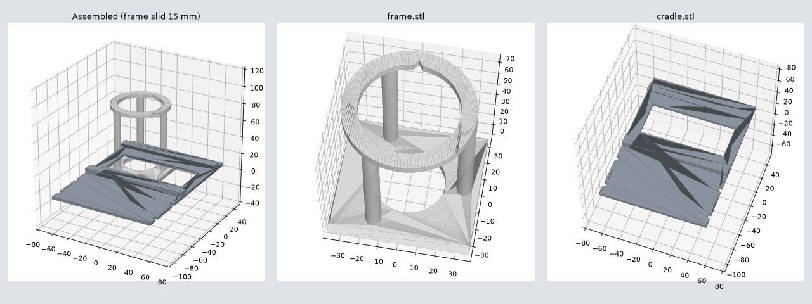

# SkinRing gadget (hardware)

Prototype phone spacer for the SkinRing app. **Not certified, not a medical device** – see the main README.



The skin ring sits on the skin, the phone's main camera looks through it from a fixed distance, and the flashlight gives the same lighting every time. The app uses the ring (50 mm opening) as its measuring scale.

## Parts

| File | What | Print orientation |
|---|---|---|
| `frame.stl` | Skin ring (50 mm opening, V-notch at 12 o'clock, recess for a grey reference sticker on the camera side) + 3 struts + slider plate | as exported: slider plate on the bed, ring on top |
| `cradle.stl` | Phone plate with viewing slot, dovetail rails and notches for two rubber bands | as exported: flat side (phone side) on the bed |
| `skinring_gadget.py` | Parametric source – change ring size, distance, plate sizes and re-run | – |

Fixed distance camera lens → skin: **80 mm**. Both parts fit a 220 × 220 mm bed, no supports needed.

## Print settings

PETG (or PLA for a first fit test) · 0.4 mm nozzle · 0.20 mm layers · 4 perimeters · 25–35 % infill · no supports.

## You also need

- 2 rubber bands (hair ties work) to hold the phone on the cradle
- a **red** marker or red sticker for the notch – the app finds the 12 o'clock notch by its red colour
- a small grey (or white) sticker, about 7 × 7 mm, for the recess on the camera side of the ring

## Assembly and use

1. Colour the V-notch red and put the grey sticker into the recess on the camera side of the ring.
2. Slide the frame's plate into the cradle's rails (from either end). It should move sideways with light friction; if it is too tight or loose, change `CLEARANCE` and re-print the cradle.
3. Lay the phone with its back on the flat side of the cradle, main camera over the slot, and hold it with the two rubber bands.
4. Open the SkinRing camera, then slide the frame sideways and the phone up or down until the ring is centred in the preview.
5. In the app, check Settings → ring inner diameter = 50 mm.

## Regenerate the STLs

```
pip install manifold3d numpy
python skinring_gadget.py .
```

## Status

First design, checked in software only (closed meshes, parts do not collide over the full slide range). Not yet printed – check the fit, the focus distance of your phone (some phones switch to a macro lens close up) and the ring detection in the app before relying on it.
